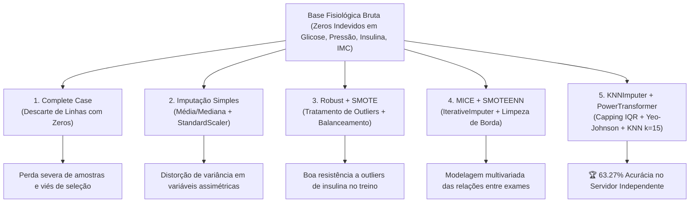

# Machine Learning & Applied Artificial Intelligence Portfolio

[](https://www.python.org/)
[](https://scikit-learn.org/)
[](https://pandas.pydata.org/)
[](https://numpy.org/)
[](https://scipy.org/)
[](https://imbalanced-learn.org/)
[](https://jupyter.org/)
[](./mlclass/LICENSE)

Repositório estruturado de **Ciência de Dados, Aprendizado de Máquina (Supervisionado e Não-Supervisionado), Otimização e Inteligência Artificial Aplicada**. 

Projetado com rigor estatístico, este portfólio reúne soluções completas de ponta a ponta: desde a formulação do problema e auditoria de integridade dos dados, passando por engenharia de atributos sem vazamento (*leakage-free*), validação cruzada estratificada, benchmarking de múltiplos algoritmos, até técnicas de interpretabilidade (*Explainable AI - XAI*) e serialização de artefatos de inferência em produção (*MLOps*).

---

## 📌 Sumário Executivo do Portfólio

| Projeto | Domínio / Dataset | Paradigma de ML | Algoritmos & Técnicas Principais | Principais Resultados / Métricas |
|---|---|---|---|---|
| [**Detecção de Fraude Financeira**](#1-detecção-de-fraude-em-cartão-de-crédito-imbalanced-learning) | Financeiro / Transações de Crédito (`creditcard.csv`) | Classificação Supervisionada em Desbalanceamento Extremo | Auditoria IQR, Log-Transform, `ColumnTransformer`, `RobustScaler`, k-NN com `GridSearchCV`, Regressão Logística, Random Forest | Identificação de anomalias em base com 0.172% de fraudes; otimização de Precision-Recall AUC e F1-Score |
| [**Seleção de Modelos Multiclasse & MLOps**](#2-seleção-e-validação-de-classificadores-multiclasse-abalone-dataset) | Biométrico / Idade de Abalone (`abalone_dataset.csv`) | Classificação Multiclasse Supervisionada | Stratified 5-Fold CV, SVM (RBF/Linear), Regressão Logística Multinomial, Random Forest, LDA, Dummy Baseline | **SVM (RBF): 65.27% Acurácia** e **64.70% F1-macro**; pipeline serializado em `.pkl` pronto para produção |
| [**Clustering Biométrico & Perfilamento Ocular**](#3-clustering-biométrico--descoberta-de-perfis-oculares-barrett-ii) | Oftalmológico / Biometria Ocular (`barrettII_eyes_clustering.csv`) | Aprendizado Não-Supervisionado & XAI | K-Means, Hierarchical Ward, DBSCAN, PCA, t-SNE, Radar Plots, Árvore de Decisão Substituta (*Surrogate*) | Descoberta de 2 biótipos clínicos estáveis (Silhouette: 0.2867; CH: 760.43); **regras explicáveis com 90.31% de acurácia** em validação cruzada |
| [**Clustering Espacial de Mapas Epiteliais**](#4-clustering-espacial-de-mapas-epiteliais-corneanos-oct-rtvue) | Oftalmológico / OCT Espectral (`RTVue_20221110_MLClass.csv`) | Aprendizado Não-Supervisionado Espacial | Paquimetria em 8 setores cardinais (C, S, ST, T, IT, I, IN, N, SN), índices de assimetria vertical ($\Delta I-S$) | Segmentação fenotípica para triagem precoce de ceratocone e ectasias corneanas |
| [**Estudo de Ablação em Pré-Processamento**](#5-estudo-de-ablação-em-técnicas-de-pré-processamento--imputação-pima-indians) | Clínico / Risco de Diabetes (`diabetes_dataset.csv`) | Engenharia de Dados & Imputação Avançada | Comparação de 5 abordagens: Remoção, Imputação pela Média, SMOTE + Robust, MICE (`IterativeImputer`), KNNImputer + PowerTransformer | **63.27% de acurácia em teste cego** no servidor de avaliação independente via `KNNImputer(k=15)` + `PowerTransformer(yeo-johnson)` |
| [**Aprendizado por Reforço & Ambientes Interativos**](#6-aprendizado-por-reforço--ambientes-de-simulação-ple) | Teoria de Decisão & Jogos | Reinforcement Learning (RL) | PyGame Learning Environment (PLE), Formulação de MDP (Estados, Ações, Recompensas), Catcher, Maze, Flappy Bird, Doom | Modelagem de agentes inteligentes em ambientes estocásticos discretos |
| [**Otimização Metaheurística Global**](#7-otimização-metaheurística-global-padrão-de-radiação-de-antenas) | Telecomunicações / Eletromagnetismo | Busca Estocástica & Otimização Contínua | Subida da Encosta (*Hill Climbing*), Têmpera Simulada (*Simulated Annealing*), Algoritmos Genéticos (*GA*) | Maximização do ganho de radiação 3D de antena em sistema de coordenadas esféricas |

---

## 🔬 Detalhamento dos Projetos

### 1. Detecção de Fraude em Cartão de Crédito (Imbalanced Learning)
📁 **Arquivo:** [`Lista_1_Antônio_Rodrigo.ipynb`](./Lista_1_Antônio_Rodrigo.ipynb)  
📊 **Base:** 284.807 transações europeias de cartão de crédito (`creditcard.csv`)

O desafio central reside no **desbalanceamento severo da variável alvo**: apenas 492 transações são fraudulentas (**0.172%** da base). O notebook foi construído seguindo um protocolo profissional de 10 etapas:

1. **Diagnóstico Estrutural & Auditoria de Qualidade:**
   - Verificação de tipos primitivos, valores nulos e cardinalidade.
   - Auditoria de consistência temporal e financeira: identificação de mais de 18.000 outliers extremos na coluna `Amount` via método da Amplitude Interquartil ($3 \times IQR$).
2. **Engenharia de Atributos & Tratamento de Assimetria:**
   - Transformação logarítmica de `Amount` para atenuar o impacto da assimetria extrema (razão de 290.8x entre média e máximo).
   - Engenharia de atributos temporais relativos às janelas de transação.
3. **Pipeline de Pré-Processamento sem Vazamento (*Leakage-Free*):**
   - Encapsulamento com `ColumnTransformer` e `Pipeline` do Scikit-Learn.
   - Escalonamento com `RobustScaler` nas variáveis de montante e tempo, mantendo preservadas as 28 variáveis latentes geradas previamente por PCA ($V_1$ a $V_{28}$).
4. **Otimização de Hiperparâmetros & Benchmarking:**
   - Ajuste sistemático de $k$, métrica de distância e esquema de pesos do classificador $k$-NN via `GridSearchCV`.
   - Comparação multi-modelo ($k$-NN, Regressão Logística, Random Forest) avaliando curvas de Precisão-Revocação (PR-AUC), F1-Score da classe minoritária e ROC-AUC para evitar a ilusão da acurácia ingênua em dados desbalanceados.

---

### 2. Seleção e Validação de Classificadores Multiclasse (Abalone Dataset)
📁 **Diretório:** [`mlclass/03_Validation/Questao_2_ML/`](./mlclass/03_Validation/Questao_2_ML/) | 📄 [Documentação Detalhada](./mlclass/03_Validation/Questao_2_ML/README.md)  
📊 **Bases:** `abalone_dataset.csv` (3.132 amostras com rótulo) e `abalone_app.csv` (1.045 amostras de teste cego)

Projeto voltado à classificação multiclasse (classes I, II e III correspondentes a faixas etárias de moluscos marinhos) a partir de variáveis biométricas (comprimento, diâmetro, altura, pesos corporal, concha, vísceras).

#### Metodologia & Prevenção de Data Leakage:
- Divisão rigorosa em partição de desenvolvimento e partição de teste.
- O pipeline foi construído com `ColumnTransformer`, aplicando `OneHotEncoder(drop='first')` na variável categórica `sex` e `StandardScaler()` nas variáveis contínuas, ajustando os parâmetros estatísticos exclusivamente no conjunto de treino.

#### Benchmark de 8 Modelos (Stratified 5-Fold Cross-Validation):
Os modelos foram avaliados sob as mesmas dobras estratificadas, reportando média e desvio padrão:

| Modelo | Acurácia Média | Desvio Padrão (Acc) | F1-Score Macro | Desvio Padrão (F1) | Veredito |
|---|:---:|:---:|:---:|:---:|---|
| 🥇 **SVM (Kernel RBF)** | **65.27%** | $\pm 2.58\%$ | **64.70%** | $\pm 2.46\%$ | **Melhor capacidade de generalização e separabilidade não-linear** |
| 🥈 **Regressão Logística (Multinomial)** | 64.91% | $\pm 2.01\%$ | 64.44% | $\pm 1.91\%$ | Altamente estável, convergência rápida e interpretabilidade direta |
| 🥉 **SVM (Kernel Linear)** | 64.63% | $\pm 2.09\%$ | 64.55% | $\pm 2.02\%$ | Limítrofe ao RBF com menor custo computacional |
| **Random Forest (100 árvores)** | 63.59% | $\pm 2.78\%$ | 63.24% | $\pm 2.57\%$ | Robustez a ruídos nas medidas de peso |
| **LDA (Linear Discriminant Analysis)** | 63.23% | $\pm 2.24\%$ | 63.38% | $\pm 2.11\%$ | Bom poder discriminante linear |
| **k-NN ($k=5$)** | 61.44% | $\pm 2.24\%$ | 61.09% | $\pm 2.10\%$ | Sensível à multicolinearidade entre dimensões |
| **Árvore de Decisão** | 57.40% | $\pm 2.88\%$ | 57.02% | $\pm 2.80\%$ | Tendência a sobreajuste nas partições |
| **Dummy (Mais Frequente - Baseline)** | 34.41% | $\pm 0.14\%$ | 17.07% | $\pm 0.05\%$ | Linha de base estocástica |

#### Interpretabilidade Estatística & Artefatos de Produção:
- Estudo aprofundado dos coeficientes da Regressão Logística Multinomial em [`docs/regressao-logistica-por-dentro.md`](./mlclass/03_Validation/Questao_2_ML/docs/regressao-logistica-por-dentro.md), identificando quais razões de peso (`shucked_weight` vs `shell_weight`) aumentam a chance de transição de classe etária.
- Serialização completa do pipeline de inferência em [`pipeline_output/final_pipeline.pkl`](./pipeline_output/final_pipeline.pkl).

---

### 3. Clustering Biométrico & Descoberta de Perfis Oculares (Barrett II)
📁 **Diretório:** [`atividade_3/`](./atividade_3/) | 📄 [Documentação Técnica](./atividade_3/README.md)  
📊 **Base:** Medidas biométricas oculares para cálculo de lentes intraoculares (`barrettII_eyes_clustering.csv`)

Aplicação de mineração de dados não-supervisionada para segmentação anatômica em pacientes oftalmológicos com base em 5 dimensões biométricas:
- **AL** (*Axial Length* - Comprimento axial do olho)
- **ACD** (*Anterior Chamber Depth* - Profundidade da câmara anterior)
- **WTW** (*White-to-White* - Diâmetro horizontal da córnea)
- **K1 e K2** (*Keratometry* - Curvaturas corneanas em meridianos ortogonais)

```
       [ Biometria Bruta ]
                │
         StandardScaler
                │
    ┌───────────┴───────────┐
    │  Validação de K       │ ──> Elbow Method & Silhouette Score
    └───────────┬───────────┘
                │
  ┌─────────────┼─────────────┐
  │             │             │
K-Means    Hierarchical    DBSCAN
(Particional) (Ward Link) (Densidade)
  │             │             │
  └─────────────┼─────────────┘
                │
      Métricas Comparativas
 (Silhouette: 0.2867 | CH: 760.43 | DB: 1.2582)
                │
    ┌───────────┴───────────┐
    │  Interpretabilidade   │
    │  - Radar Charts       │ ──> Perfil Curto/Curvo vs Longo/Plano
    │  - Árvore Substituta  │ ──> 90.31% acurácia na extração de regras
    └───────────────────────┘
```

#### Resultados Quantitativos e Validação dos Agrupamentos:
- **K-Means ($K=2$):** Apresentou o equilíbrio ótimo entre separabilidade e interpretabilidade clínica (Silhouette: **0.2867**, Calinski-Harabasz: **760.43**, Davies-Bouldin: **1.2582**).
- **Hierarchical Clustering (Ward Linkage):** Confirmou a existência de duas macro-famílias anatômicas no dendrograma (Silhouette: 0.2438, CH: 569.32).
- **DBSCAN:** Identificou o agrupamento principal de alta densidade e isolou casos anatômicos atípicos (outliers morfológicos severos).

#### Explainable AI (XAI) e Comunicação com Médicos:
- **Perfil 1 ("Olhos Curtos e Curvos"):** Baixo $AL$, menor $ACD$ e córneas com alta curvatura diópica ($K1/K2$). Padrão de hipermetropia anatômica.
- **Perfil 2 ("Olhos Longos e Planos"):** Elevado $AL$, câmara anterior profunda ($ACD$) e córneas planas. Padrão de miopia axial.
- **Árvore de Decisão Substituta:** Treinada para explicar as fronteiras do K-Means a partir das medidas originais, alcançando **$90.31\% \pm 1.60\%$ de acurácia em validação cruzada 5-fold** (`decision_tree_results.json`).
- O repositório inclui slides de consultoria em formato Marp ([`slides-v2.md`](./atividade_3/slides-v2.md)) e roteiro de apresentação clínica ([`roteiro.md`](./atividade_3/roteiro.md)).

---

### 4. Clustering Espacial de Mapas Epiteliais Corneanos (OCT RTVue)
📁 **Diretório:** [`atividade_4/`](./atividade_4/) | 📄 [Documentação Técnica](./atividade_4/README.md)  
📊 **Base:** Tomografia de Coerência Óptica de Domínio Espectral (`RTVue_20221110_MLClass.csv`)

O epitélio corneano é uma camada de espessura micrométrica que compensa irregularidades do relevo estromal anterior. Este projeto analisa a morfologia de mapas epiteliais paquimétricos divididos em **8 setores cardinais e zona central**:

$$\text{Setores: } \{C, S, ST, T, IT, I, IN, N, SN\}$$

- **Relevância Médica:** Em ectasias como o ceratocone subclínico (*form fruste*), o epitélio sofre afinamento focal agudo no setor inferotemporal ($IT$) e inferior ($I$), acompanhado de espessamento no anel periférico.
- **Modelagem Não-Supervisionada:** Agrupamento de pacientes a partir dos vetores de espessura e índices de assimetria espacial derivados ($\Delta_{I-S} = \text{Inferior} - \text{Superior}$), permitindo a detecção precoce de anomalias anatômicas antes da manifestação de sintomas clínicos visuais.

---

### 5. Estudo de Ablação em Técnicas de Pré-Processamento & Imputação (Pima Indians)
📁 **Notebooks:** [`Machine_learning_01_*.ipynb`](./)  
📊 **Base:** Predição de Diabetes (*Pima Indians Diabetes Dataset* do NIDDK / 768 amostras)

Nesta série de experimentos, foi realizado um estudo metódico de ablação comparando como diferentes decisões de pré-processamento impactam o poder de generalização do algoritmo $k$-NN:



#### Comparativo das Abordagens de Engenharia de Dados:
1. [`Machine_learning_01_jogando_fora.ipynb`](./Machine_learning_01_jogando_fora.ipynb):
   - **Estratégia:** Eliminação direta de registros que continham valor zero em variáveis onde zero é biologicamente impossível (Glicose, Pressão, IMC).
   - **Diagnóstico:** Perda substancial do tamanho amostral e geração de viés de seleção não aleatório (*Missing Not At Random*).
2. [`Machine_learning_01_com_media.ipynb`](./Machine_learning_01_com_media.ipynb):
   - **Estratégia:** Imputação univariada tradicional (média/mediana) + `StandardScaler`.
   - **Diagnóstico:** Reduz a variância intrínseca dos dados e introduz picos artificiais na densidade de variáveis com distribuição bimodal ou assimétrica (ex: Insulina).
3. [`Machine_learning_01_balanceamento_robust.ipynb`](./Machine_learning_01_balanceamento_robust.ipynb):
   - **Estratégia:** Imputação mediana + `RobustScaler` (baseado na faixa interquartil $IQR$) + rebalanceamento da classe minoritária com `SMOTE` restrito à partição de treino.
   - **Diagnóstico:** Reduz o efeito destrutivo de outliers nas distâncias do $k$-NN e balanceia a fronteira de decisão.
4. [`Machine_learning_01_diogo.ipynb`](./Machine_learning_01_diogo.ipynb):
   - **Estratégia:** Imputação multivariada encadeada via `IterativeImputer` (MICE) + `QuantileTransformer` + `SMOTEENN` (técnica combinada de sobreamostragem e limpeza de ruído por vizinhos mais próximos).
5. [`Machine_learning_01_powerscaler_knn.ipynb`](./Machine_learning_01_powerscaler_knn.ipynb):
   - **Estratégia:** Capping de outliers por IQR + `KNNImputer(n_neighbors=15)` (preservação da geometria local do espaço fisiológico) + `PowerTransformer(method='yeo-johnson')` para estabilização de variância e conversão das distribuições para formato aproximadamente gaussiano.
   - **Resultado:** **63.27% de acurácia** validada no servidor de avaliação independente do professor.

---

### 6. Aprendizado por Reforço & Ambientes de Simulação (PLE)
📁 **Diretório:** [`mlclass/04_ReinforcementLearning/`](./mlclass/04_ReinforcementLearning/)

Implementação e exploração de algoritmos de **Reinforcement Learning** interagindo com ambientes controlados através da biblioteca *PyGame Learning Environment* (PLE):
- **Formulação de Processo de Decisão de Markov (MDP):** Espaço de estados contínuo/discreto, espaço de ações discretas e função de recompensa adaptada para aprendizado de políticas de controle.
- **Ambientes Integrados:**
  - `Catcher`: Captura de objetos em queda com recompensa por acerto e penalidade por perda de bola.
  - `RaycastMaze`: Navegação 2D em labirinto com percepção de raios de distância (LiDAR simplificado).
  - `Doom`, `Flappy Bird`, `Pixelcopter`, `Monster Kong`: Jogos clássicos em 2D para benchmarking de agentes baseados em gradiente de política e $Q$-Learning.

---

### 7. Otimização Metaheurística Global (Padrão de Radiação de Antenas)
📁 **Diretório:** [`mlclass/02_Optimization/`](./mlclass/02_Optimization/)

Resolução de problemas de otimização em espaços contínuos não-convexos através de algoritmos de busca estocástica e melhoria iterativa:
- **Problema Modelado:** Otimização da geometria de elementos de uma antena no espaço esférico tridimensional $(\rho, \theta, \phi)$ para maximizar a diretividade e o ganho do lóbulo de radiação eletromagnética (inspirado no projeto evolutivo da antena ST5 da NASA).
- **Algoritmos Implementados:**
  - **Subida da Encosta (*Hill Climbing*):** Busca local com variações de reinício aleatório (*Random Restart*) para fuga de ótimos locais.
  - **Têmpera Simulada (*Simulated Annealing*):** Probabilidade de aceitação de soluções de transição decrescente controlada pelo parâmetro de temperatura ($e^{-\Delta E / T}$).
  - **Algoritmos Genéticos (*Genetic Algorithms*):** População de candidatos, seleção por torneio/roleta, recombinação cromossômica e mutação contínua.

---

## 🏗️ Estrutura do Repositório

```
ml/
├── Lista_1_Antônio_Rodrigo.ipynb         # Detecção de Fraude em Cartão de Crédito (10 etapas completas)
├── Machine_learning_01_powerscaler_knn.ipynb # Pipeline avançado KNNImputer + PowerTransformer (Diabetes)
├── Machine_learning_01_balanceamento_robust.ipynb # Pipeline com RobustScaler e SMOTE
├── Machine_learning_01_diogo.ipynb       # Pipeline com MICE (IterativeImputer) e SMOTEENN
├── Machine_learning_01_com_media.ipynb   # Baseline com Imputação pela Média
├── Machine_learning_01_jogando_fora.ipynb # Baseline com Remoção de Nulos (Complete Case)
├── requirements.txt                      # Dependências reproduzíveis do ambiente
│
├── atividade_3/                          # PROJETO: Clustering Biométrico Ocular (Barrett II)
│   ├── README.md                         # Documentação detalhada do projeto
│   ├── pipeline_Barrett_II.ipynb         # Pipeline integrado de clustering
│   ├── notebooks/                        # 8 cadernos modulares (EDA, Find-K, KMeans, DBSCAN, Ward, Validação)
│   ├── results/                          # Relatórios interativos exportados em HTML
│   ├── imgs/                             # Gráficos em alta resolução (Elbow, Silhouette, Radar, PCA/t-SNE)
│   ├── validation_metrics.csv            # Tabela consolidada de métricas de agrupamento
│   ├── decision_tree_results.json        # Acurácia da árvore explicável (90.31%)
│   ├── roteiro.md                        # Roteiro de apresentação executiva para clínica médica
│   └── slides-v2.md                      # Slides executivos no formato Marp
│
├── atividade_4/                          # PROJETO: Clustering Espacial de Espessura Epitelial (OCT RTVue)
│   ├── README.md                         # Documentação anatômica e guia de execução
│   ├── RTVue_20221110_MLClass.csv        # Dataset paquimétrico dos 8 setores corneanos
│   └── notebooks/01_data_loading.ipynb   # Ingestão, auditoria e limpeza dos dados de OCT
│
├── mlclass/                              # MÓDULOS DE APRENDIZAGEM DE MÁQUINA (UFAL)
│   ├── 01_Preprocessing/                 # Dados de Diabetes e scripts de envio
│   ├── 02_Optimization/                  # Metaheurísticas de antena (Hill Climbing, Simulated Annealing, GA)
│   ├── 03_Validation/
│   │   └── Questao_2_ML/                 # PROJETO: Benchmark e Model Selection Abalone
│   │       ├── 01 a 05_*.ipynb           # Cadernos sequenciais de EDA, Transformação, Validação e Deploy
│   │       ├── docs/                     # Insights, análise de coeficientes e submissão
│   │       └── README.md                 # Documentação completa do benchmark
│   ├── 04_ReinforcementLearning/         # PyGame Learning Environment (PLE), jogos e agentes
│   └── 05_IOL_H1/                        # Avaliação de classificadores em cirurgia oftalmológica
│
├── pipeline_output/                      # Artefatos exportados para deploy (MLOps)
│   ├── final_pipeline.pkl                # Pipeline treinado completo do Scikit-Learn (SVM RBF)
│   ├── preprocessor.pkl                  # Transformador de atributos serializado
│   └── model_comparison.csv              # Métricas de acurácia e F1 de todos os modelos avaliados
│
├── slides_ab2/ & provas_antigas/         # Sínteses teóricas (Clustering, Regras de Associação, Apriori)
└── ml/cc/exercises/                      # Tutoriais avançados de computação científica com NumPy e Pandas
```

---

## 💡 Princípios de Engenharia de Machine Learning Adotados

- **Zero Data Leakage:** Estatísticas descritivas, médias de imputação e parâmetros de escalonamento (`fit`) são estritamente aprendidos na partição de treino e aplicados (`transform`) aos dados de teste e validação.
- **Pipelines Nativos & Modulares:** Uso extensivo de `sklearn.pipeline.Pipeline` e `sklearn.compose.ColumnTransformer` para garantir transformações atômicas, reproduzíveis e desacopladas de código manual de transformação.
- **Métricas Adequadas ao Problema:**
  - Em classes desbalanceadas: substituição da acurácia ingênua por **Macro F1-Score**, **Curvas Precision-Recall** e **PR-AUC**.
  - Em clustering: diagnóstico multi-métrica via **Coeficiente de Silhueta**, **Calinski-Harabasz** e **Davies-Bouldin**, associados a reduções não-lineares (**t-SNE** e **PCA**).
- **Interpretabilidade (XAI):** Tradução dos resultados dos modelos para a tomada de decisão do usuário final através de modelos substitutos (*surrogate models* com árvores explicáveis), gráficos de radar e inspeção analítica de coeficientes.
- **MLOps & Serialização de Artefatos:** Persistência de pipelines integrados de transformação e inferência em arquivos `.pkl` independentes.

---

## 🛠️ Tecnologias e Bibliotecas Utilizadas

- **Linguagem Principal:** Python 3.10+
- **Manipulação & Análise de Dados:** Pandas, NumPy, SciPy, OpenPyXL
- **Machine Learning & Otimização:** Scikit-Learn, Imbalanced-Learn (`imblearn`)
- **Visualização de Dados:** Matplotlib, Seaborn
- **Ambientes de Simulação & RL:** PyGame Learning Environment (PLE), PyGame
- **Computação Interativa & Documentação:** Jupyter Notebook, JupyterLab, Marp (Slides Markdown)

---

## 🚀 Como Configurar e Executar o Ambiente

### 1. Clonar o Repositório
```bash
git clone https://github.com/rodrigololr/ml.git
cd ml
```

### 2. Criar e Ativar um Ambiente Virtual
```bash
# No Linux / macOS:
python3 -m venv venv
source venv/bin/activate

# No Windows:
python -m venv venv
venv\Scripts\activate
```

### 3. Instalar as Dependências
```bash
pip install --upgrade pip
pip install -r requirements.txt
```

### 4. Iniciar o Jupyter Lab ou Jupyter Notebook
```bash
jupyter lab
# ou
jupyter notebook
```

Navegue pelos cadernos dos projetos (ex: [`Lista_1_Antônio_Rodrigo.ipynb`](./Lista_1_Antônio_Rodrigo.ipynb) ou [`atividade_3/pipeline_Barrett_II.ipynb`](./atividade_3/pipeline_Barrett_II.ipynb)) para executar ou reproduzir as análises.

---

## 👤 Autor

**Antônio Rodrigo Lima de Andrade Tenório**  
Estudante de Ciência da Computação — Instituto de Computação (IC)  
Universidade Federal de Alagoas (UFAL)  
- GitHub: [@rodrigololr](https://github.com/rodrigololr)
