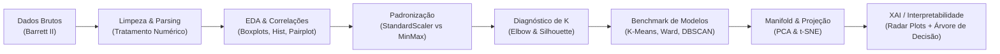

# Clustering Biométrico & Descoberta de Perfis Oculares (Barrett II)

Projeto de **Aprendizado Não-Supervisionado (Unsupervised Machine Learning)** aplicado à biometria oftálmica para descoberta de padrões fenotípicos da anatomia ocular em candidatos a implante de lentes intraoculares (LIO).

---

## 📋 Visão Geral & Desafio de Negócio / Clínico

Em cirurgias de catarata e implante de lentes intraoculares, a fórmula de **Barrett II Universal** utiliza medidas biométricas para prever o poder dióptrico ideal da lente. Este projeto utilizou técnicas de mineração de dados e clustering para responder a uma pergunta clínica central:

> *"Existem perfis anatômicos naturais distintos na população de pacientes? Quais são as características diagnósticas de cada grupo e como traduzi-las em regras de decisão explicáveis?"*

A abordagem adotada foi estritamente não-supervisionada: os agrupamentos foram descobertos diretamente das relações espaciais dos dados, sem viés de classes pré-estabelecidas.

---

## 🔬 Dicionário de Variáveis Biométricas

| Variável | Medida Oftalmológica | Significado Clínico | Unidade |
|---|---|---|---|
| **AL** | *Axial Length* | Comprimento axial anteroposterior total do olho (córnea à retina) | mm |
| **ACD** | *Anterior Chamber Depth* | Profundidade da câmara anterior (córnea ao cristalino) | mm |
| **WTW** | *White-to-White* | Distância limbo a limbo horizontal (diâmetro da córnea) | mm |
| **K1** | *Flattest Keratometry* | Curvatura corneana no meridiano mais plano | Dioptrias (D) |
| **K2** | *Steepest Keratometry* | Curvatura corneana no meridiano mais curvo | Dioptrias (D) |
| *Correto* | *Target de auditoria* | Sucesso da predição refrativa prévia (**não usado** no agrupamento; reservado para análise diagnóstica *a posteriori*) | S / N |

---

## ⚙️ Metodologia & Pipeline de Machine Learning



### 1. Preparação e Pré-processamento
- Conversão de padrões numéricos e tratamento de decimais.
- Avaliação comparativa entre `StandardScaler` (média 0, variância 1) e `MinMaxScaler` [0, 1]. O `StandardScaler` foi selecionado por preservar a representatividade de variabilidade intrínseca das medidas oculares.

### 2. Diagnóstico de Hiperparâmetros (Determinação de $K$)
- **Método do Cotovelo (Elbow Method):** Ponto de inflexão nítido da inércia intra-cluster em $K=2$.
- **Análise de Silhueta:** Coeficiente de silhueta médio máximo em $K=2$, com distribuição balanceada de densidade entre os dois agrupamentos e ausência de silhuetas negativas expressivas.

### 3. Benchmark de Algoritmos de Agrupamento
Foram avaliados 3 paradigmas fundamentais de clustering:
1. **Particional (K-Means):** Otimização baseada em centróides e distância euclidiana.
2. **Hierárquico Aglomerativo (Ward Linkage):** Minimização da variância intra-cluster com geração de dendrograma.
3. **Baseado em Densidade (DBSCAN):** Ajuste de $\varepsilon$ via gráfico de $k$-distâncias para identificação de núcleos de alta densidade e detecção de anomalias/outliers morfológicos.

---

## 📊 Resultados e Validação de Clusters

Os modelos foram validados quantitativamente através de métricas internas de compactação e separabilidade:

| Método | N° Clusters | Silhouette Score | Calinski-Harabasz (CH) | Davies-Bouldin (DB) | Diagnóstico |
|---|:---:|:---:|:---:|:---:|---|
| **K-Means ($K=2$)** | **2** | **0.2867** | **760.43** | **1.2582** | **Melhor partição global e balanceamento** |
| **Hierarchical (Ward)** | 2 | 0.2438 | 569.32 | 1.3868 | Boa convergência hierárquica |
| **DBSCAN** | 2 (+ ruído) | 0.5441 | 13.06 | 4.5533 | Isola outliers anatômicos, mas gera clusters desbalanceados |

---

## 🧠 Interpretabilidade Clínica & Explainable AI (XAI)

Para que o modelo não fosse uma "caixa preta", foram empregadas duas técnicas de interpretabilidade:

### 1. Radar Plots Fenotípicos (Perfis Oculares Descobertos)
- **Perfil 1 — "Olhos Curtos e Curvos (Padrão Hipermetrópico)":**
  - Menor comprimento axial ($AL$ baixo), câmara anterior mais rasa ($ACD$ baixo) e curvaturas corneanas elevadas ($K1$ e $K2$ altos).
- **Perfil 2 — "Olhos Longos e Planos (Padrão Miópico)":**
  - Maior comprimento axial ($AL$ alto), câmara anterior profunda ($ACD$ alto) e córneas mais planas ($K1$ e $K2$ baixos).

### 2. Extração de Regras via Árvore de Decisão Substituta (Surrogate Model)
Uma árvore de decisão foi treinada para predizer os rótulos do K-Means a partir das medidas biométricas originais:
- **Acurácia em Validação Cruzada (5-fold):** **$90.31\% \pm 1.60\%$** (`decision_tree_results.json`)
- As regras obtidas demonstram que $AL$ (comprimento axial) e $ACD$ são os biomarcadores primários que separam os dois biótipos, permitindo que cirurgiões compreendam instantaneamente a atribuição do paciente a cada grupo.

---

## 📈 Visualizações do Projeto

Os gráficos gerados durante a execução do pipeline encontram-se no diretório `imgs/`:
- `imgs/elbow_plot.png` — Curva de inércia para escolha de $K$.
- `imgs/silhouette_plot.png` — Coeficiente de silhueta por cluster.
- `imgs/kmeans_pca_tsne.png` — Projeções 2D dos clusters via PCA e t-SNE.
- `imgs/radar_kmeans.png` — Assinatura biométrica dos clusters (gráfico de radar).
- `imgs/dendrogram.png` — Dendrograma do agrupamento hierárquico aglomerativo.
- `imgs/pairplot.png` & `imgs/correlation.png` — Relações bivariadas e multicolinearidade corneana.

---

## 🗂️ Estrutura de Arquivos

```
atividade_3/
├── notebooks/                         # Cadernos passo a passo do fluxo de trabalho
│   ├── 01_data_loading.ipynb          # Carga, tipagem e higienização
│   ├── 02_eda.ipynb                   # Análise exploratória bivariada e correlações
│   ├── 03_preprocessing.ipynb         # Escalonamento StandardScaler vs MinMax
│   ├── 04_find_k.ipynb                # Curvas de Elbow e Silhouette
│   ├── 05_kmeans.ipynb                # Ajuste do K-Means e avaliação
│   ├── 06_dbscan.ipynb                # DBSCAN e k-distance plot
│   ├── 07_hierarchical.ipynb          # Agrupamento hierárquico e dendrograma
│   └── 08_validation.ipynb            # Validação cruzada, PCA/t-SNE, radar e surrogate tree
├── pipeline_Barrett_II.ipynb          # Pipeline integrado de ponta a ponta
├── results/                           # Relatórios interativos exportados em HTML
├── imgs/                              # Gráficos estatísticos e projeções em alta resolução
├── roteiro.md                         # Roteiro de apresentação executiva para clínica médica
├── slides-v2.md / slides.html         # Apresentação executiva em formato Marp
├── validation_metrics.csv             # Tabela comparativa de métricas dos modelos
└── decision_tree_results.json         # Métricas de validação da árvore explicável
```

---

## 🚀 Como Executar

Execute o pipeline unificado ou os cadernos individuais via Jupyter:

```bash
jupyter notebook pipeline_Barrett_II.ipynb
```
ou execute sequencialmente os notebooks dentro de `notebooks/01_data_loading.ipynb` até `notebooks/08_validation.ipynb`.
