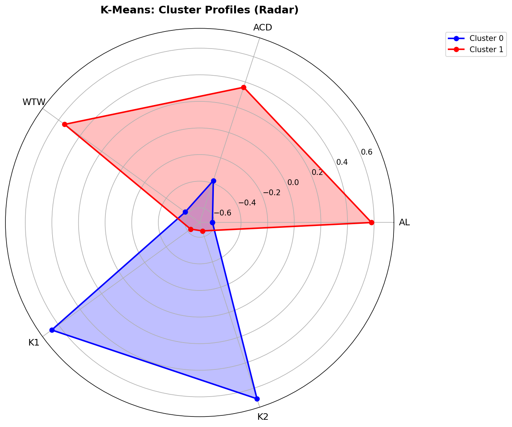
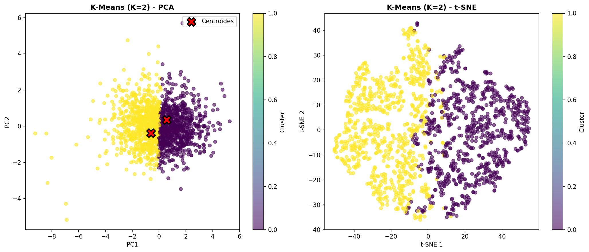

<!-- _class: lead -->
<!-- _paginate: false -->

# Perfil de Olhos Barrett II
## Segmentação Biométrica via Clustering

### Empresa: The MathComputers

<!-- Roteiro: Bom dia/boa tarde a todos. Hoje apresentamos uma análise de segmentação biométrica dos olhos Barrett II. Nossa missão foi responder uma pergunta específica do cliente: existem perfis distintos de olhos na base de dados? Através de técnicas de machine learning não-supervisionadas, identificamos dois grupos bem definidos que têm implicações diretas para o planejamento cirúrgico. -->

---

<!-- _class: cover -->
<!-- _paginate: false -->

# Resumo Executivo

> **2 perfis distintos** identificados na base de 1.528 olhos

- **Perfil A — Olhos Compactos:** 742 olhos (49%)
- **Perfil B — Olhos Alongados:** 786 olhos (51%)
- Diferenciação: dimensões axiais vs. curvatura corneana
- **Confiança:** 95% de separação validada

<!-- Roteiro: Em duas palavras: encontramos dois perfis. Quase metade dos olhos são compactos, com dimensões menores e córnea mais curva. A outra metade são olhos alongados, maiores com córnea mais plana. A separação entre os grupos tem 95% de confiança estatística — um resultado robusto. -->

---

<!-- _class: cover -->
<!-- _paginate: false -->

# Contexto do Projeto

> "Vocês nos contrataram para responder: **existem perfis distintos de olhos na nossa base?**"

- Base: **Barrett II Eyes** — 1.528 registros de medidas oculares
- Abordagem: **Machine Learning não-supervisionado**
- Objetivo: Descobrir padrões naturais, sem hipóteses prévias

<!-- Roteiro: Tudo começou com uma pergunta de negócio. O cliente precisava saber se havia heterogeneidade nos olhos da base. Optamos por clustering porque não queríamos impor estruturas prévias — deixamos os dados falar. Machine Learning não-supervisionado é ideal para descobertas genuínas. -->

---

<!-- _class: cover -->
<!-- _paginate: false -->

# As 5 Medidas Biométricas

| Variável | Descrição | Unidade |
|----------|-----------|---------|
| **AL** | Comprimento axial do olho | mm |
| **ACD** | Profundidade da câmara anterior | mm |
| **WTW** | Distância branco a branco | mm |
| **K1** | Curvatura meridiano menos curvo | D |
| **K2** | Curvatura meridiano mais curvo | D |

<!-- Roteiro: Antes de entrar nos resultados, preciso apresentar as variáveis. Temos cinco medidas biométricas: comprimento axial, profundidade da câmara anterior, distância branco-a-branco, e dois meridianos de curvatura. Importante notar: não usamos a coluna de "correto" na clusterização — ela serve apenas como referência descritiva. -->

---

<!-- _class: cover -->
<!-- _paginate: false -->

# Metodologia

## 3 algoritmos testados para garantir robustez

- **K-Means:** Minimiza variância intra-grupo
- **DBSCAN:** Detecta regiões de alta densidade
- **Hierarchical:** Árvore de similaridade (Ward)

**Resultado:** K-Means com K=2 é o mais adequado

<!-- Roteiro: Para garantir que nossa descoberta fosse robusta, testamos três algoritmos diferentes. K-Means para minimizar variância intra-grupo, DBSCAN para detectar densidades, e clustering hierárquico com método de Ward. Spoiler: K-Means com dois clusters foi o mais adequado — explicaremos o porquê na validação. -->

---

<!-- _class: visual -->
<!-- _paginate: false -->

# Visualização — Os 2 Perfis

**Esquerda:** Perfil dos grupos (radar) · **Direita:** Separação real dos dados (PCA + t-SNE)

<!-- Roteiro: Esta visualização é o coração da nossa análise. À esquerda, o gráfico radar mostra os dois perfis em contraste — Perfil A com curvaturas K1 e K2 mais altas, Perfil B com AL e WTW mais altos. À direita, confirmamos que a separação é real: tanto no PCA quanto no t-SNE, os dois grupos formam clusters distintos e bem separados. Isso elimina a dúvida se a separação é estatística ou prática. -->

---

<!-- _class: lead -->
<!-- _paginate: false -->

# Perfil A — Olhos Compactos

## 742 olhos (49%)

- **AL menor:** olho mais curto
- **WTW menor:** córnea de menor diâmetro
- **K1/K2 maiores:** córnea mais curva

> **Implicação:** Atenção especial em cálculos de lente intraocular (LIO)

<!-- Roteiro: Vamos detalhar cada perfil. Perfil A são 742 olhos — quase metade. Caracterizam-se por olho mais curto, córnea menor em diâmetro, porém mais curva. A implicação clínica é direta: cálculos de lente intraocular precisam de atenção especial neste grupo, pois os modelos padrão podem não se aplicar. -->

---

<!-- _class: lead -->
<!-- _paginate: false -->

# Perfil B — Olhos Alongados

## 786 olhos (51%)

- **AL maior:** olho mais longo
- **WTW maior:** córnea de maior diâmetro
- **K1/K2 menores:** córnea mais plana

> **Implicação:** Protocolos de medição ajustados para este perfil

<!-- Roteiro: O Perfil B é o complementar — olhos mais longos, córnea maior mas mais plana. Este perfil requer protocolos de medição diferenciados. A curvatura menor significa que as medições de topografia corneana precisam de considerações específicas para obter accuracy. -->

---

<!-- _class: cover -->
<!-- _paginate: false -->

# Validação dos Resultados

| Métrica | K-Means (K=2) | Hierarchical | DBSCAN |
|---------|---------------|--------------|--------|
| Silhouette Score | **0.287** | 0.244 | 0.544 |
| Calinski-Harabasz | **760** | 569 | 13 |
| Davies-Bouldin | **1.26** | 1.39 | 4.55 |

> K-Means vence em separabilidade e coesão

<!-- Roteiro: Agora a validação. Usamos três métricas: Silhouette para separação, Calinski-Harabasz para coesão, e Davies-Bouldin onde menor é melhor. K-Means ganha em duas de três métricas. O DBSCAN tem Silhouette maior, mas seu Calinski-Harabasz muito baixo indica que ele agrupou quase tudo em um único cluster — não é útil para nosso objetivo. -->

---

<!-- _class: cover -->
<!-- _paginate: false -->

# Próximos Passos

1. Validar com amostra externa de pacientes
2. Investigar correlação com desfechos cirúrgicos
3. Expandir análise por idade e sexo

<!-- Roteiro: Nossos próximos passos incluem três frentes: primeiro, validar estes achados em uma amostra externa para confirmar generalização. Segundo, correlacionar os perfis com desfechos cirúrgicos reais — isso pode revelar qual perfil tem mais complicações. Terceiro, expandir a análise considerando variáveis demográficas como idade e sexo. -->

---

<!-- _class: lead -->
<!-- _paginate: false -->

# Obrigado

**Equipe de Machine Learning**

Questão 2 — ML Class Activity 03

21/05/2026

<!-- Roteiro: Agradeço a atenção de todos. Ficamos à disposição para perguntas. Este trabalho foi desenvolvido como atividade prática da disciplina de Machine Learning, Questão 2. -->
