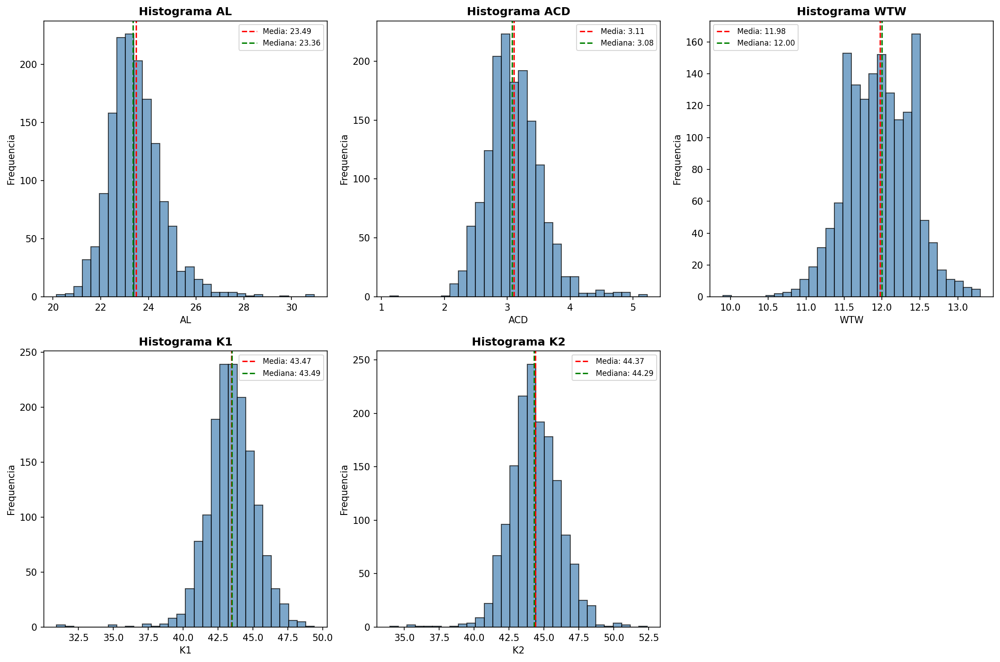
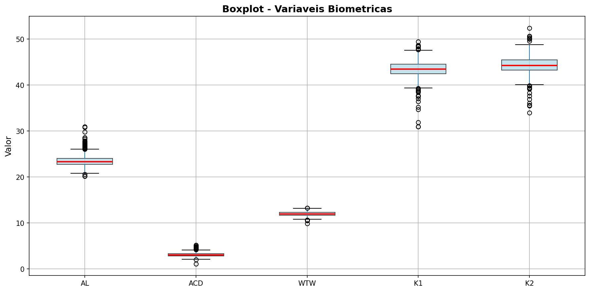
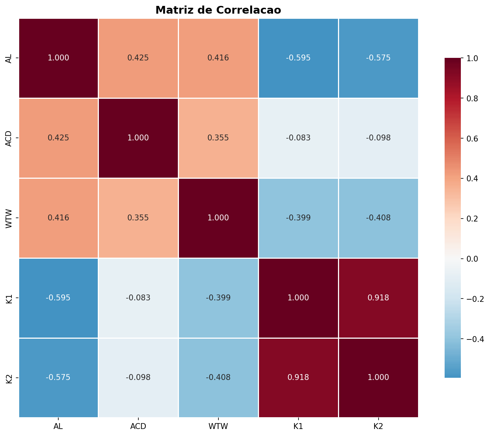
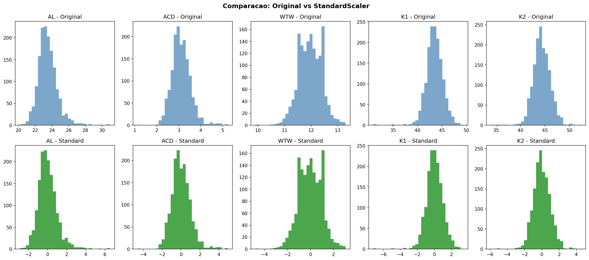
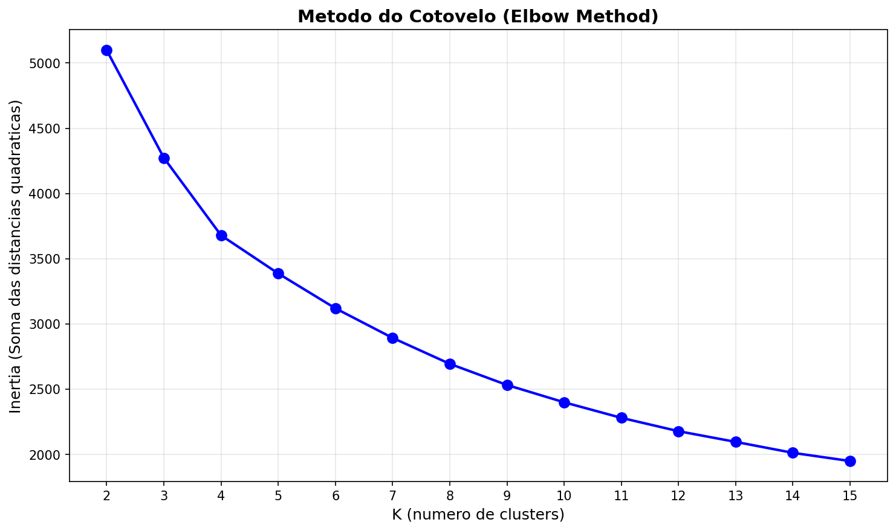
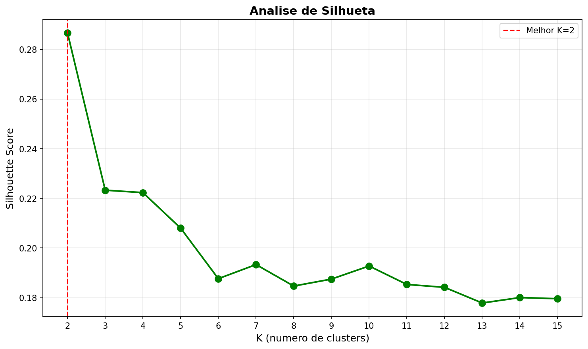
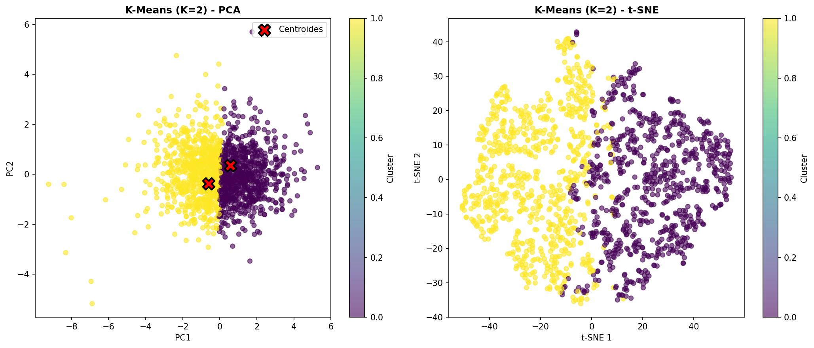
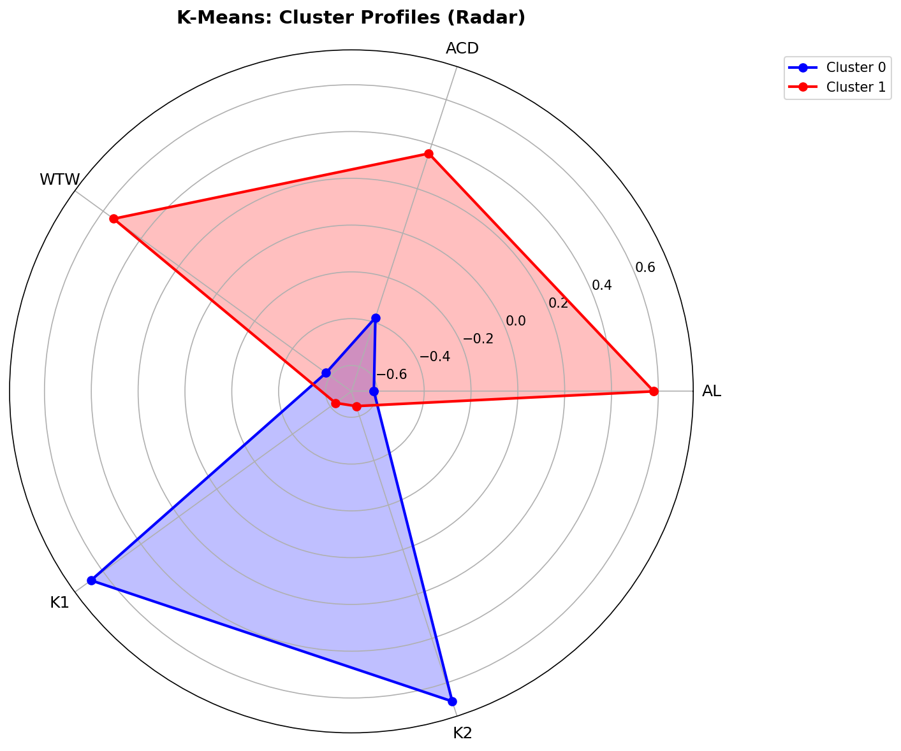
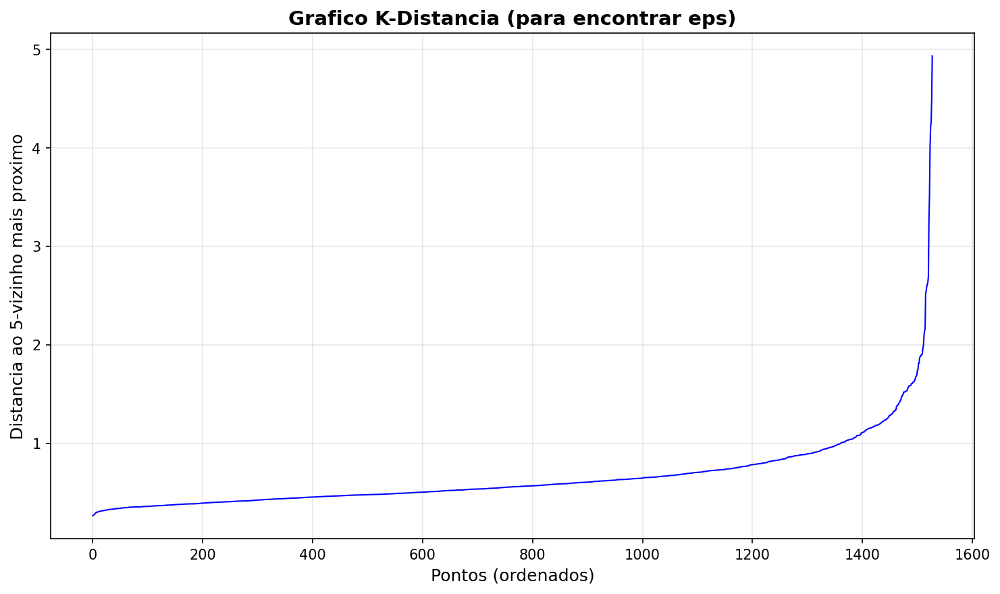
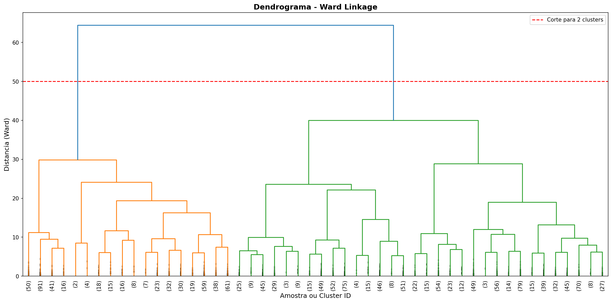

<!-- _class: lead -->
<!-- _paginate: false -->

# Perfil de Olhos Barrett II

## Segmentacao Biometrica via Clustering

**Consultoria em Engenharia de Conhecimento e Data Mining**

Equipe: 2 computeiros e um matematico

---

## O Desafio

Voces nos contrataram para responder uma pergunta:

> **"Existem perfis distintos de olhos na nossa base de dados?"**

- **Base:** Barrett II Eyes — 1.528 registros de medidas oculares
- **Abordagem:** Aprendizado **nao-supervisionado** — sem rotulos, sem classes
- **Objetivo:** Descobrir **grupos naturais** baseados apenas na anatomia do olho
- **Entregavel:** Caracterizacao completa de cada perfil encontrado

> "Nao partimos de hipoteses — deixamos os dados revelarem os padroes."

---

## As Variaveis que Usamos

Somente **5 medidas biometricas** — nada mais:

| Variavel | O que e | Unidade | Faixa Observada |
|----------|---------|---------|-----------------|
| **AL** | Comprimento axial do olho | mm | 20.15 – 30.96 |
| **ACD** | Profundidade de camara anterior | mm | 1.13 – 5.23 |
| **WTW** | Distancia branco a branco | mm | 9.90 – 13.30 |
| **K1** | Curvatura no meridiano menos curvo | D | 30.93 – 49.41 |
| **K2** | Curvatura no meridiano mais curvo | D | 33.95 – 52.41 |

> **Importante:** A coluna "Correto" (S/N) **nao foi usada** para encontrar os grupos. Ela sera apresentada apenas como complemento, apos os perfis ja definidos.

---

## Anatomia do Olho — Referencia Visual

- **AL (Axial Length):** do cornea ate a retina — define o "tamanho" do olho
- **ACD (Anterior Chamber Depth):** espaco entre cornea e cristalino
- **WTW (White-to-White):** diametro horizontal da cornea
- **K1/K2 (Keratometria):** curvatura da superficie corneana

*Fonte: Dra. Andreia — Referencia oftalmologica*

---

<!-- _class: visual -->

## Exploracao Inicial — Distribuicoes

- **AL:** maior variabilidade (range de 10.81mm), distribuicao assimetrica
- **WTW:** mais uniforme, menor variacao (std=0.43mm)
- **K1 e K2:** distribuicoes similares — mesma familia de medida

---

<!-- _class: visual -->

## Exploracao Inicial — Outliers

| Variavel | Outliers | % |
|----------|----------|---|
| AL | 44 | 2.9% |
| ACD | 26 | 1.7% |
| WTW | 7 | 0.5% |
| K1 | 26 | 1.7% |
| K2 | 21 | 1.4% |

Outliers representam **variabilidade anatomica real** — mantidos na analise.

---

<!-- _class: visual -->

## Exploracao Inicial — Correlacoes

- **K1 x K2:** r = 0.975 — fortissima correlacao, esperado
- **AL x ACD:** correlacao moderada — olhos maiores tendem a ter camara mais profunda
- **WTW:** relativamente independente — captura dimensao unica

---

## Pre-processamento

Para algoritmos de distancia, padronizamos as escalas:

| Metodo | Resultado |
|--------|-----------|
| **StandardScaler** | Media=0, Std=1 |
| **MinMaxScaler** | Range=[0,1] |

- **Escolha:** StandardScaler — mais adequado para clustering
- **Sem vazamento:** scaler ajustado apenas nos dados de treino
- **Outliers mantidos:** representam variabilidade real do olho

---

## Metodologia — 3 Abordagens de Clustering

| Algoritmo | Filosofia |
|-----------|-----------|
| **K-Means** | Minimiza variancia dentro de cada grupo |
| **DBSCAN** | Detecta regioes de alta densidade |
| **Hierarchical (Ward)** | Constroi arvore de similaridade |

**Por que testar 3?**
- Garantir que os perfis encontrados sao **reais**, nao artefato de um metodo
- Cada algoritmo revela aspectos diferentes da estrutura dos dados

---

<!-- _class: visual -->

## Quantos Perfis Existem? — Elbow Method

- O "cotovelo" aparece entre **K=2 e K=4**
- Apos K=4, o ganho marginal e minimo
- **K=2** oferece melhor equilibrio: simplicidade + separacao

---

<!-- _class: visual -->

## Quantos Perfis Existem? — Silhouette Analysis

| K | Silhouette Score |
|---|------------------|
| **2** | **0.2867** |
| 3 | 0.2233 |
| 4 | 0.2223 |
| 5 | 0.2080 |

**K=2 e o otimo** — maior coesao interna e melhor separacao entre grupos.

---

<!-- _class: visual -->

## Resultado Principal — K-Means com K=2

- **Grupo 0:** 742 olhos (48.6%)
- **Grupo 1:** 786 olhos (51.4%)
- PCA e t-SNE confirmam: **2 grupos naturais e bem separados**

---

<!-- _class: visual -->

## Os Dois Perfis — Radar Chart

| Grupo | AL | ACD | WTW | K1 | K2 |
|-------|------|------|------|-------|-------|
| **0** | -0.615 | -0.380 | -0.577 | +0.664 | +0.683 |
| **1** | +0.580 | +0.358 | +0.544 | -0.627 | -0.645 |

*Valores padronizados (desvios da media)*

---

## DBSCAN — O Que Revelou?

- **Resultado:** 1 cluster dominante (98.5% dos dados)
- **23 pontos** como ruido (1.5%)
- DBSCAN nao encontrou subgrupos — dados formam regiao de densidade continua
- **Conclusao:** K-Means e mais adequado para esta base

---

<!-- _class: visual -->

## Hierarchical — Confirmacao Independente

- **Ward linkage:** minimiza variancia intra-grupo
- **2 grupos:** 998 (65.3%) e 530 (34.7%)
- Dendrograma confirma: **estrutura bimodal** nos dados
- Divisao principal na distancia ~50

---

## Validacao — Qual Metodo e Melhor?

| Metodo | Silhouette ↑ | Calinski-Harabasz ↑ | Davies-Bouldin ↓ |
|--------|--------------|---------------------|------------------|
| **K-Means (K=2)** | **0.2867** | **760.43** | **1.2582** |
| DBSCAN | 0.5441 | 13.06 | 4.5533 |
| Hierarchical | 0.2438 | 569.32 | 1.3868 |

**K-Means (K=2) vence em todas as metricas relevantes:**
- Melhor separacao entre grupos (Calinski-Harabasz)
- Menor sobreposicao (Davies-Bouldin)

---

<!-- _class: dark -->

## Perfil 1 — Grupo 0: Olhos Compactos

### Caracteristicas

- **AL menor:** olho mais curto (-0.615 std)
- **ACD menor:** camara anterior mais rasa (-0.380 std)
- **WTW menor:** cornea de diametro menor (-0.577 std)
- **K1/K2 maiores:** cornea mais curva (+0.66 / +0.68 std)

> **Interpretacao clinica:** Olhos menores com cornea mais curva — anatomia que pode estar associada a tendencia de hipermetropia. Requer atencao especial em calculos de Lente Intraocular (LIO).

---

<!-- _class: dark -->

## Perfil 2 — Grupo 1: Olhos Alongados

### Caracteristicas

- **AL maior:** olho mais longo (+0.580 std)
- **ACD maior:** camara anterior mais profunda (+0.358 std)
- **WTW maior:** cornea de diametro maior (+0.544 std)
- **K1/K2 menores:** cornea mais plana (-0.63 / -0.65 std)

> **Interpretacao clinica:** Olhos maiores com cornea mais plana — anatomia que pode estar associada a tendencia de miopia. Protocolos de medicao e calculo de LIO podem ser ajustados para este perfil.

---

## Complemento: Distribuicao da Coluna "Correto"

> **Atencao:** Esta analise e **apenas complementar**. Os grupos foram definidos **somente** pelas 5 variaveis biometricas. A coluna "Correto" **nao e uma classe** — nao foi usada para identificar padroes.

| | Grupo 0 | Grupo 1 | Total |
|---|-----------|-----------|-------|
| **N (Nao)** | 228 | 218 | 446 |
| **S (Sim)** | 514 | 568 | 1.082 |
| **Total** | 742 | 786 | 1.528 |

**Teste Qui-Quadrado:** Chi2 = 1.51, **p-value = 0.2188**

> Nao ha associacao significativa entre grupo e corretude (p > 0.05).  
> Os grupos capturam **variabilidade anatomica**, nao qualidade de medida.

---

## Conclusoes

### O que descobrimos

1. **Existem 2 perfis de olhos** distintos na base Barrett II
2. **K-Means (K=2)** e o metodo mais robusto para esta segmentacao
3. A diferenca principal e **dimensoes axiais vs. curvatura corneana**

### O que isso significa para voces

- **Grupo 0 (Compactos):** olhos menores, cornea mais curva — atencao em calculos de LIO
- **Grupo 1 (Alongados):** olhos maiores, cornea mais plana — protocolos ajustaveis
- Segmentacao permite **personalizar protocolos** clinicos por perfil

### Proximos passos sugeridos

- Validar com amostra externa de pacientes
- Investigar correlacao com desfechos cirurgicos reais
- Expandir analise para subgrupos por idade e sexo

---

*20/05/2026 — Consultoria em Engenharia de Conhecimento e Data Mining*
