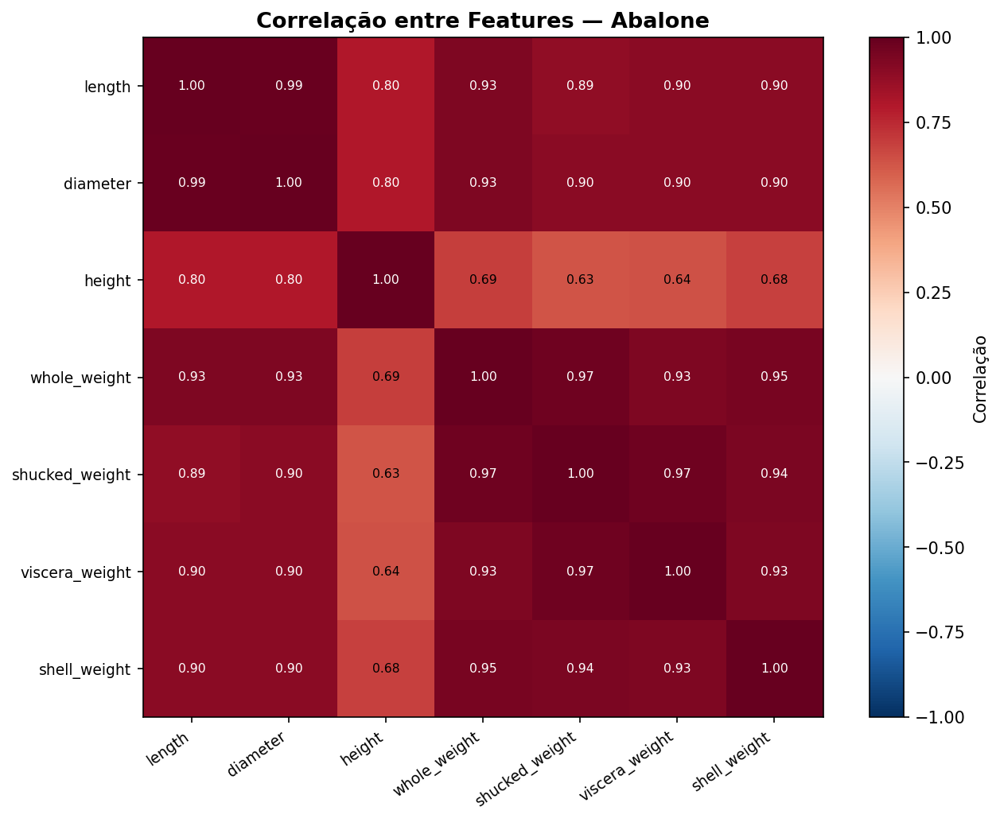
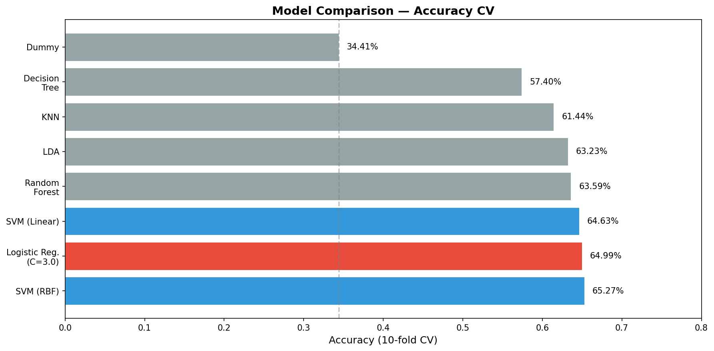
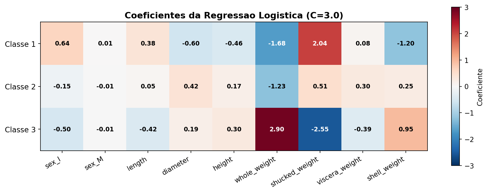
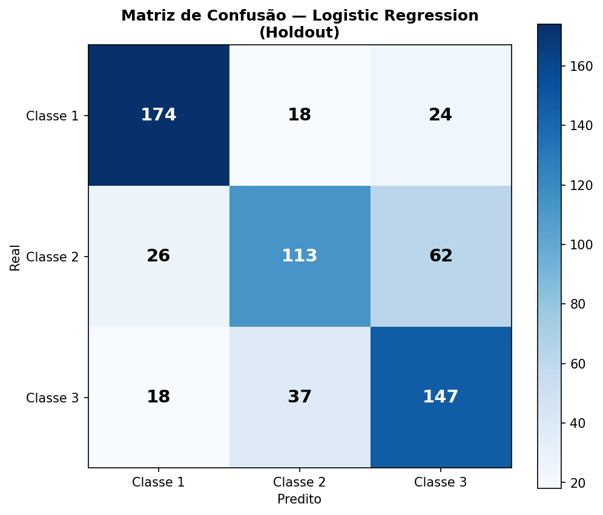

<!-- _class: lead -->
<!-- _paginate: false -->

# Abalone Classification

**Atividade 03 — Avaliacao de Classificadores**

Equipe: 2 computeiros e um matematico  
Modelo final: Regressao Logistica (C=3.0)  
Resultado oficial: **64.31%** de acuracia no servidor

---

## O Problema

- Classificar Abalone em **3 tipos** (1, 2 e 3)
- **8 features**: sexo, comprimento, diametro, altura, pesos
- **3.132** registros de treino e **1.045** de aplicacao
- Classes balanceadas: **34% / 32% / 34%**
- Objetivo: boa validacao local e envio ao servidor oficial

---

## EDA — O Que Descobrimos

<!-- _class: visual -->

- Features **muito correlacionadas** (length x diameter = 0.99)
- `sex` muito informativa: infantil = classe 1, femea = classe 3
- LDA: componente 1 explica **88.4%** da variancia discriminante
- **Classe 2** e a mais dificil (sobreposicao com classe 3)

---

## Pre-processamento

- **Split estratificado**: 80% treino / 20% validacao
- `sex` = OneHotEncoder (drop='first') = **sex_I, sex_M**
- Numericas = **StandardScaler**
- Sem vazamento: scaler ajustado **so no treino**
- Resultado: **9 features** (2 dummy + 7 padronizadas)

---

## Comparacao de Modelos

<!-- _class: visual -->

- **SVM (RBF)** liderou a validacao cruzada
- **Logistic Regression** ficou muito perto
- Modelos lineares foram fortes desde o inicio
- Dummy confirmou que existe sinal real na base

---

## Por Que Logistic Regression?

- **Trade-off:** performance vs interpretabilidade
- Diferenca para SVM (RBF): apenas **0.28%** em CV
- Logistic Regression entrega coeficientes explicaveis
- C=3.0 foi o melhor ajuste testado para o modelo
- SVM (RBF) ficou como benchmark de desempenho

---

## O Modelo Explica as Classes

<!-- _class: visual -->

- **Classe 1**: `sex_I` e `shucked_weight`
- **Classe 3**: `whole_weight` e `shell_weight`
- **Classe 2**: intermediaria, com maior sobreposicao
- Coeficientes ajudaram na defesa do modelo com o professor

---

## Resultado no Servidor

<!-- _class: visual -->

- Acuracia oficial: **64.31%**
- Predicoes enviadas: **1.045**
- Distribuicao coerente com o treino
- Pipeline completo validado: EDA = preprocessamento = modelagem = submissao

---

## Conclusao

- Regressao Logistica foi a escolha certa para a defesa
- SVM (RBF) foi o melhor benchmark, mas com pouca vantagem
- Classe 2 continua sendo o gargalo do problema
- O pipeline ficou limpo, estratificado e sem vazamento

**O modelo mais simples foi o suficiente.**

---

*28/04/2026 — Atividade 03 — Machine Learning*
