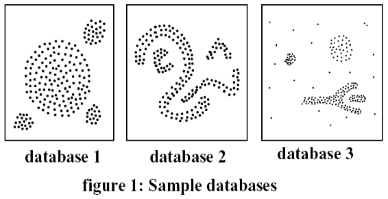

# AB2 - Prova de Aprendizagem de Máquina

## Questões

### 1. Descreva um dos algoritmos não-supervisionados: k-means, k-medoids ou dbscan?

k-means: Ele é baseado em centroide, onde em va

### 2. Que algoritmo de clustering você usaria para cada uma das databases da figura abaixo? Explique o porquê da sua escolha.

### 3. Descreva o algoritmo de mineração de regras de associação Apriori.
