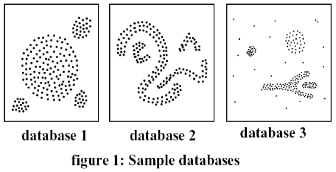

# AB2 - Prova de Aprendizagem de Máquina (Respondida para Estudos)

Este documento contém as questões da prova AB2 resolvidas com base estrita nos slides do professor (Clustering e Regras de Associação).

---

## Questões e Respostas

### 1. Descreva um dos algoritmos não-supervisionados: k-means, k-medoids ou dbscan?

*   **K-Means (Baseado em Centroides / Particionamento):**
    *   **Funcionamento:** Organiza $n$ objetos em $k$ grupos (clusters) definidos pelo usuário. O algoritmo escolhe aleatoriamente $k$ objetos iniciais como centróides. Em seguida, repete o processo de: (1) associar cada objeto ao centróide mais próximo e (2) recalcular o centróide de cada grupo como sendo o valor médio (média aritmética) dos objetos pertencentes a ele. O processo para quando não houver mais alterações na associação dos pontos.
    *   **Objetivo:** Minimizar a soma das distâncias quadráticas entre os objetos e os centróides de seus respectivos clusters.
    *   **Limitações:** Não é adequado para identificar clusters de formato não-convexo (arbitrário) e não trabalha bem com ruídos/outliers.

*   **K-Medoids / PAM (Baseado em Representantes Reais / Particionamento):**
    *   **Funcionamento:** Semelhante ao K-Means, porém o representante (centro) de cada cluster não é a média dos pontos, mas sim um **objeto real** pertencente ao cluster (chamado de medóide). O algoritmo busca a escolha de medóides que minimize a soma das distâncias entre os objetos e o medóide do seu cluster.
    *   **Vantagem:** É muito mais adequado para bases de dados com ruídos e outliers, pois o medóide (ponto real do conjunto) não sofre o desvio que a média aritmética sofre com pontos extremos.

*   **DBSCAN (Baseado em Densidade):**
    *   **Funcionamento:** Agrupa os dados com base na densidade local de pontos. Ele utiliza dois parâmetros principais: um raio ($R$ ou $\epsilon$) e uma densidade mínima (número mínimo de pontos). 
    *   **Vantagens:** O número de clusters ($k$) **não** precisa ser definido previamente pelo usuário. Ele é ideal para identificar clusters de formatos arbitrários (não-convexos) e realiza um excelente tratamento de ruídos, classificando pontos isolados automaticamente como outliers (ruídos).

---

### 2. Que algoritmo de clustering você usaria para cada uma das databases da figura abaixo? Explique o porquê da sua escolha.

*   **Database 1: K-Means** (ou K-Medoids)
    *   **Por quê:** Os dados formam grupos bem distribuídos, esféricos (convexos), de tamanhos e densidades semelhantes, além de estarem bem separados. Nessas condições de geometria simples, o K-Means é altamente eficiente e convergirá rapidamente.
*   **Database 2: DBSCAN**
    *   **Por quê:** Os dados apresentam geometrias não-convexas de formatos arbitrários (círculos concêntricos e formas lineares/curvas). O K-Means e o K-Medoids falham nesses casos pois tentam forçar divisões esféricas e lineares. O DBSCAN, por ser baseado em densidade de pontos próximos, é o único capaz de mapear e separar esses formatos complexos perfeitamente.
*   **Database 3: K-Medoids** (ou DBSCAN)
    *   **Por quê:** A base de dados apresenta muitos ruídos e outliers dispersos que distorcem o agrupamento. O K-Means seria muito afetado, pois a média aritmética é puxada por esses outliers. O K-Medoids resolve isso por utilizar pontos reais como representantes (medóides), tornando-se robusto contra ruídos. O DBSCAN também seria viável por conseguir separar e isolar os ruídos automaticamente.

---

### 3. Descreva o algoritmo de mineração de regras de associação Apriori.

O **Apriori** é um algoritmo utilizado para extrair regras de associação do tipo $X \Rightarrow Y$ em bases transacionais, garantindo que as regras encontradas tenham suporte e confiança maiores ou iguais aos limites mínimos definidos pelo usuário ($SupMin$ e $ConfMin$).

#### As Duas Fases do Algoritmo:
1.  **Fase 1 (Identificação de Conjuntos Frequentes):** Encontra todos os conjuntos de itens ($Z$) que possuem suporte maior ou igual ao suporte mínimo ($Sup(Z) \ge SupMin$). Esta é a fase computacionalmente mais cara.
2.  **Fase 2 (Geração de Regras):** Para cada conjunto frequente $Z$, identifica seus possíveis subconjuntos $X$ e $Y$ de forma que $Z = X \cup Y$ e a confiança seja satisfatória ($\text{Confiança}(X \Rightarrow Y) = \frac{Sup(Z)}{Sup(X)} \ge ConfMin$).

#### A Estratégia Apriori (Redução do Espaço de Busca):
Para evitar avaliar todas as $2^n$ combinações possíveis de itens, o Apriori utiliza o princípio de que:
*   **Propriedade Apriori:** Todo subconjunto de um conjunto frequente também deve ser frequente.
*   **Poda (Contra-positiva):** Se um conjunto de itens não é frequente, qualquer superconjunto contendo ele também não será frequente (e é descartado sem precisar ler a base).

#### Geração de Candidatos ($C_k$ a partir de $F_{k-1}$):
A cada iteração $k$, o algoritmo gera novos candidatos de tamanho $k$ em duas etapas:
1.  **Junção:** Une pares de conjuntos frequentes de tamanho $k-1$ ($F_{k-1}$) que compartilham os primeiros $k-2$ itens.
2.  **Poda:** Examina cada candidato gerado e o elimina caso ele contenha algum subconjunto de tamanho $k-1$ que **não** seja frequente.
